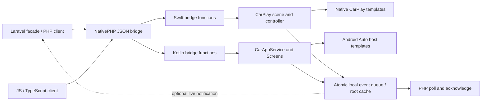

# Architecture

## Package boundary

Composer metadata identifies a `nativephp-plugin`. `nativephp.json` declares 14 bridge functions, native class mappings, the event class, Android service/dependencies/resource and the CarPlay scene. Every Kotlin bridge class has explicit constructor parameters: context-only methods can be registered without a handset Activity; only `BindEvents` takes an Activity.

The Laravel provider binds a replaceable `Transport`, the client and configuration. `NativeTransport` calls `nativephp_call` and accepts NativePHP 4's direct response format as well as a success envelope. The JavaScript client targets the host controller and unwraps its envelope. Neither transport invents fake native success when the runtime is missing.

The `post_compile` hook selects the approved iOS category from application configuration and updates generated XML plists. It uses NativePHP's supported hook context and edits the generated host, not the installed plugin's manifest. Registering the package does not overwrite the application's SwiftUI phone scene.

## Native startup

The system can launch an in-car experience before the phone interface. Swift creates `NativeCarPlaySceneDelegate`; Android binds `NativeCarAppService` and creates a Session/Screen. Both restore a validated root from native storage. A safe empty list is used if content is absent/invalid.

No hidden phone Activity is launched and no assumption is made that PHP is already executing. Cached row/action identifiers remain actionable as events. PHP can process them after the runtime resumes. Fresh, server-dependent behavior while suspended requires an additional native data/background-runtime integration; it is not supplied by a persisted UI document.

## Threading and operations

CarPlay controller/rendering state belongs to the main dispatch queue. Android Screen/ScreenManager state belongs to the main looper. The bridge validates payloads before scheduling; a scheduled command returns a UUID rather than waiting synchronously for the host. This avoids a PHP/native/UI circular wait.

Swift serializes host operations, tracks connection generations, limits waiting operations and imposes a host-completion timeout. A disconnect fails the active operation and prevents its old completion callback from committing cached state into the next session. Kotlin posts bounded operations to the main looper and catches native model/host exceptions. Both publish a completion event.

Read-only status/queue operations use synchronized snapshots. Native callback completions for list/search interactions are answered immediately from local data; they never wait for PHP. Business operations travel through events.

## Templates and state

Templates are data-only documents. PHP, Swift and Kotlin enforce a common bounded contract, and the host enforces additional platform/category/task constraints. Android trims lists/grids/points using `ConstraintManager` on API 2+, with conservative fallback counts for API 1. Newer functions are guarded by negotiated car API levels.

Root documents persist. Screen stacks, alerts, tab selection and query UI state do not. In-place replacement preserves the native screen stack where supported. IDs identify logical items/actions, rather than exposing PHP routes to the vehicle host. Native-created Android POI detail screens preserve their parent point/template IDs when dispatching actions.

CarPlay search selection uses its search delegate and completes the host callback; normal lists use item handlers. These are separate callback paths. Renderer delegate state is released as templates leave the stack.

## Events and local storage

The native event stores atomically replace a bounded state file containing the cached root, events and overflow count. Events have UUIDs and are removed by explicit acknowledgement. Status reports persistence failures; acknowledgement reports whether its write succeeded. Optional live events are a convenience channel over the same queue, not a second authority for delivery.

The queue is not an execution engine, an unlimited audit log or an exactly-once transaction coordinator. Application-level idempotency belongs with the application's business transaction. Native content is not encrypted by an application-specific key; the implementation uses platform sandbox/storage protection and backup exclusions.

## Host trust

The Android service is exported because a car host must bind it. Release host validation pins the known Google Android Auto package signatures from the stable Car App Library's host list and retains the library's privileged-renderer checks. Arbitrary hosts are permitted only for Android-debuggable builds. Handset event forwarding holds an Activity weakly and avoids destroyed activities.

CarPlay availability comes from Apple's signing, entitlement and system scene machinery. The configured category is a template gate, not evidence of an approved entitlement. The integration exposes neither arbitrary network endpoints nor in-car HTML execution.

## Extending the package

Add a template to its PHP value builder, all three validators, native renderers, capability lists, TypeScript union, fixtures and platform matrix. Add bridge functions to the manifest with explicit Kotlin constructor parameters. Preserve the asynchronous command/completion contract.

The next substantial extensions are a native map surface/trip engine, a Media3/AVAudioSession media module, communication intents and Automotive packaging. Each should be a separately testable module with its own category declarations, permissions and device acceptance tests. Adding an API name without the native lifecycle behind it is insufficient.
